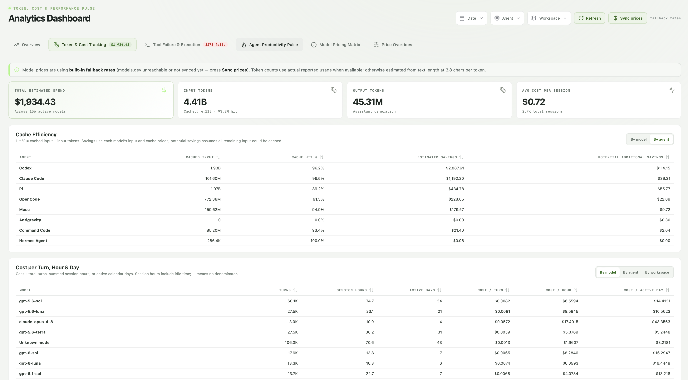
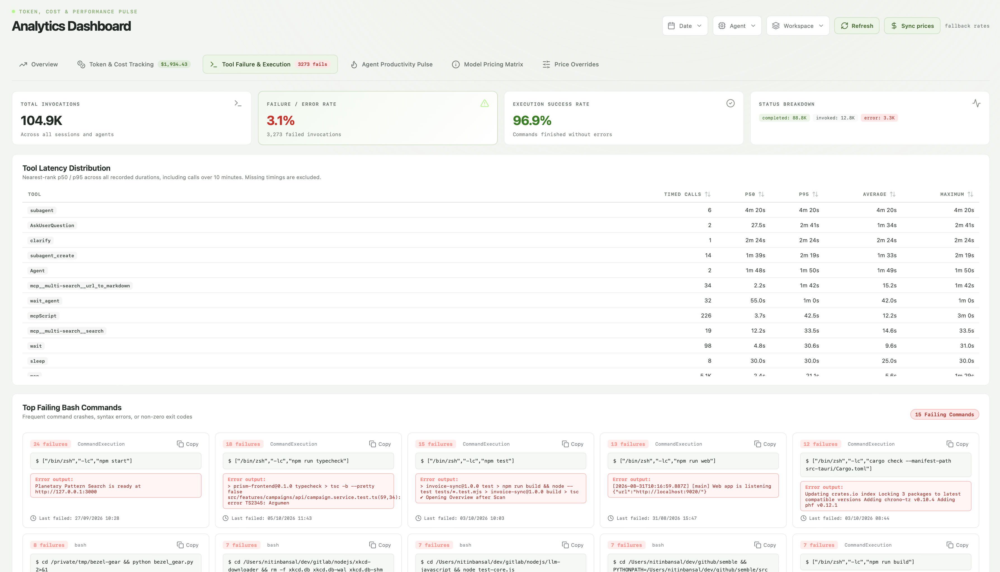

<p align="center">
  <picture>
    <source media="(prefers-color-scheme: dark)" srcset="branding/wordmark.svg">
    
  </picture>
</p>

Find the session. Pick up where you left off — on this machine or on the SSH
hosts you work on through VS Code Remote-SSH. A searchable desktop home for your
coding-agent history: transcripts, tool activity, token costs.

Hession is a hard fork of [Sessions Box](https://github.com/goodappsstore/sessions-box)
(MIT). The main addition is first-class **remote sessions**: agent histories on
your SSH hosts are mirrored and browsed, searched, analyzed, and resumed exactly
like local ones.

## Screenshots

Screenshots are from upstream Sessions Box.





## Branding lives in one place

The product name, identifier, data directory, environment-variable prefix, and
tagline come from [`brand.json`](brand.json):

| Field | Used for |
| --- | --- |
| `name` | Window title, boot screen, dialogs, exports, release names |
| `slug` | Data directory (`~/.<slug>`), binary name, file prefixes, storage keys |
| `wordmark` | Sidebar logo text (`[normal, muted]`) |
| `identifier` | Bundle identifier |
| `envPrefix` | Environment variables, e.g. `<PREFIX>_DATA_DIR` |
| `tagline`, `author` | Bundle descriptions, Cargo metadata, sidebar |

Runtime code never spells the name: the frontend imports `src/brand.js`, Rust
uses `crate::brand` (exported by `src-tauri/build.rs`), and `index.html` uses
`%BRAND_NAME%`. Static manifests (`tauri.conf.json`, `package.json`,
`Cargo.toml`) are synced by `npm run brand`, which also runs automatically before
every `npm run tauri …` and `npm run check`.

### Logo and assets

The mark is an "h" drawn as a link between two endpoints: this machine (top)
and a remote host (bottom). Sources live in [`branding/`](branding):

| File | Purpose |
| --- | --- |
| `mark.svg` | The glyph alone, 24-unit grid, `currentColor` (also used in the sidebar) |
| `icon.svg` | App icon source, 1024² on the macOS icon grid |
| `favicon.svg` | 16–32 px variant with heavier strokes |
| `wordmark.svg`, `wordmark-light.svg` | Mark + name for dark / light backgrounds *(generated)* |
| `social.svg`, `social.png` | 1280×640 GitHub social preview *(generated)* |

After editing a source SVG or renaming in `brand.json`, run `npm run icons`. It
regenerates the platform icons in `src-tauri/icons/` (via `tauri icon`), the
web assets in `public/`, and the generated files above (the PNG needs
`rsvg-convert`, from `librsvg2-bin`).

| Token | Dark | Light |
| --- | --- | --- |
| Accent (mark) | `#b8f58e` | `#497933` |
| Tile / background | `#202226` → `#0f1012` | `#f3f5f2` |
| Text | `#eceee9` | `#202624` |
| Muted (wordmark tail) | `#8f968c` | `#737b7a` |

## Remote sessions over SSH

Open **Hosts → Manage remote hosts** (server icon in the sidebar). Suggestions
come from hosts you recently opened with VS Code Remote-SSH (read from VS Code's
`state.vscdb`) and from concrete `Host` entries in `~/.ssh/config` (following
`Include`). You can also type any SSH destination (`alias` or `user@host`).
**Test** connects and reports which agent histories the host has.

On every sync (including the automatic one at startup), each enabled host is:

1. **Probed** — one `ssh host sh -s` resolves the agent stores with the host's
   own environment (`CLAUDE_CONFIG_DIR`, `CODEX_HOME`, `XDG_DATA_HOME`,
   `HERMES_HOME`, Cline's variables, …) and reports which exist. The script goes
   over stdin, so csh/tcsh login shells work.
2. **Mirrored** — one `rsync -aRz` connection pulls only transcript formats
   (`*.jsonl`, `*.json`, `*.db` and SQLite sidecars) into
   `~/.<slug>/remotes/<host>/root/<remote absolute path>`. rsync preserves
   modification times, so the importer's size + mtime check skips unchanged
   sessions exactly as it does locally. Mirrors never delete, so sessions survive
   an agent pruning old history on the host.
3. **Imported** — mirrored stores are imported with the local ones. Sessions
   carry their `host`, and workspaces are stored as `host:/path`, so the same
   path on two machines stays separate.

Hosts are mirrored in parallel. Connections use your own `ssh` and config
(ProxyJump, keys, agent, Kerberos/GSSAPI, ControlMaster all apply) with
`BatchMode=yes`: a host that needs a password or is off-VPN fails fast, keeps its
last mirror, and is reported as unreachable without marking the sync failed.
Requirements: `ssh` and `rsync` on this computer, `rsync` and a POSIX `sh` on the
host. Nothing on the host is modified.

In the library, the **Hosts** sidebar section filters by **This computer** or a
host, and remote sessions show a host chip.

- **Resume** opens a local terminal running `ssh -t <host>` that `cd`s into the
  recorded remote directory and starts the agent under your login shell (so
  nvm/conda/`~/.local/bin` PATH entries apply), then leaves you in a shell
  there. The dialog checks that the agent CLI exists on the host. **Copy
  command** gives a plain `ssh -t host 'cd … && claude --resume …'` line.
- **VS Code** opens the session's workspace: locally with `code <dir>`, remotely
  with `code --folder-uri vscode-remote://ssh-remote+<host>/<dir>`.

Remote resume is supported from Linux and macOS.

## Repository navigation

- `brand.json`: product identity (see above); `scripts/brand.mjs` applies it.
- `branding/`: logo sources and generated brand assets; `scripts/icons.mjs` builds icons.
- `src/`: React JavaScript/JSX frontend, shared components, and styles.
- `src-tauri/src/`: Rust application shell, IPC commands, storage, import/sync,
  remote hosts (`remote.rs`), analytics, pricing, saved-data management, and
  terminal resume.

## Build locally

### 1. Toolchain

- Node.js 20.19+ (20.x) or 22.12+, with npm
- Rust stable ≥ 1.85 (`rustup update stable`)
- For remote hosts at runtime: `ssh` and `rsync`

### 2. System libraries

**Debian / Ubuntu (22.04+):**

```sh
sudo apt update
sudo apt install build-essential curl wget file pkg-config libssl-dev \
  libwebkit2gtk-4.1-dev libgtk-3-dev libayatana-appindicator3-dev librsvg2-dev \
  libxdo-dev rsync
```

**Fedora:**

```sh
sudo dnf install webkit2gtk4.1-devel openssl-devel curl wget file \
  libappindicator-gtk3-devel librsvg2-devel libxdo-devel rsync
sudo dnf group install "c-development"
```

**Arch:** `sudo pacman -S --needed webkit2gtk-4.1 base-devel curl wget file openssl appmenu-gtk-module libappindicator-gtk3 librsvg xdotool rsync`

**macOS:** `xcode-select --install`. **Windows:** Microsoft C++ Build Tools and
WebView2 (preinstalled on Windows 11).

If `pkg-config` was installed by Homebrew/Linuxbrew, make sure the system one
is used, or it will not find the GTK/WebKit `.pc` files:
`PKG_CONFIG=/usr/bin/pkg-config npm run tauri dev`.

### 3. Run in development

```sh
npm ci
npm run tauri dev
```

The Vite dev server runs at `http://127.0.0.1:1420`; the window reloads on
frontend changes and rebuilds on Rust changes. Data goes to `~/.<slug>`; point
`<PREFIX>_DATA_DIR` (e.g. `HESSION_DATA_DIR=/tmp/hession-dev`) elsewhere to keep
a scratch library while developing.

### 4. Build installers

```sh
npm run tauri build                      # all bundle formats for this OS
npm run tauri build -- --bundles deb     # or appimage, rpm, dmg, nsis, msi
```

Output lands in `src-tauri/target/release/bundle/` (e.g. `deb/*.deb`,
`appimage/*.AppImage`); the plain binary is `src-tauri/target/release/<slug>`.
Install a `.deb` with `sudo apt install ./src-tauri/target/release/bundle/deb/*.deb`.

## Verify

```sh
npm run check                                   # brand sync, tsc + vite build, cargo check
cargo test --manifest-path src-tauri/Cargo.toml --lib
```

The Rust tests cover the remote layer end to end: a stand-in `ssh` runs the real
probe and rsync against a fake remote home, then the importer, and the generated
resume command is executed through `sh` with awkward paths and arguments.

## GitHub CI and releases

[`Build and publish desktop release`](.github/workflows/release.yml) runs **only
on version tag pushes** (`vMAJOR.MINOR.PATCH`). It builds macOS, Windows, and
Linux installers for x64 and ARM64 into a draft release, verifies all twelve
installers, then publishes. Release titles and asset names
(`<Name>-v<version>-<platform>-…`, spaces removed) come from `brand.json`.

Before tagging, run `python3 bump_version.py` (keeps `package.json`,
`package-lock.json`, `Cargo.toml`, `Cargo.lock`, and `tauri.conf.json` in step),
then `node .github/scripts/check-release.mjs v<version>`. macOS builds are
ad-hoc signed (not notarized); Windows installers are unsigned.

## Product details

### Desktop app

Startup displays a branded loading screen before the main interface loads,
with an animated indicator, a reassuring message for slower starts, and a
retry button if the app bundle fails to load. It respects the saved theme and
reduced-motion preferences; the library appears as soon as it is ready.
Incremental sync starts automatically after the sessions list and selected
transcript have rendered. Disable **Sync on startup** in the **Sync updates**
menu; the preference is remembered. During sync, the arrow beside **Stop sync**
opens the same menu. Choose the **Incremental** or **Full rescan** tab to sync
all agents or an individual agent. Incremental is selected when the menu opens.
The setting adds no permanent row to the interface.

### Resume sessions

Open a session and choose **Resume** to continue it in its native agent CLI
inside a visible terminal, using the original workspace directory. The dialog
shows the exact command, the working directory, and any warnings (missing CLI,
missing session file, workspace fallback). **Copy command** covers custom
terminals; **Resume in terminal** launches macOS Terminal, a Linux terminal
(`$TERMINAL` first, then common emulators), or Windows Terminal / Command
Prompt. Per-agent invocations: `codex resume <id>`, `claude --resume <id>`,
`opencode --session <ses_*>`, `pi --session <id>`,
`commandcode --session <id>`, `muse resume <uuid>`,
`hermes -p <profile> --resume <id>` (including `default` for SQLite sessions),
`cline --id <id> --tui` (SDK sessions),
`agy --conversation <uuid>`. The dialog offers a terminal picker (Terminal,
iTerm2, WezTerm, Kitty, Alacritty, Ghostty on macOS; detected emulators on
Linux; Windows Terminal / Command Prompt on Windows) — unavailable apps are
marked as not installed, and your choice is saved automatically in the local
data directory and reused for future invocations. iTerm2 runs via AppleScript,
so macOS asks once for an Automation grant; every other terminal launches
without extra permissions. Launchers carry your login-shell `PATH` (homebrew,
nvm, conda, volta, …), and a CLI that exists but fails to run is reported with
its error instead of opening a dead terminal.
Discovery uses the same augmented `PATH` as launch; Windows also recognizes
npm `.cmd`/`.bat` shims. Copied Windows commands use PowerShell syntax.

### Hermes Agent sources

Hermes Agent is supported for session imports, transcript/tool browsing,
token analytics, and resume. Choose **Sync updates** after using Hermes to
bring its saved sessions into the library. Source databases are read-only.
Binary metadata (such as Hermes message display identities) is retained as
tagged byte arrays in raw records without blocking transcript imports.

| Platform | Default session database |
| --- | --- |
| macOS / Linux | `~/.hermes/state.db` |
| Windows (native) | `%LOCALAPPDATA%\hermes\state.db` |
| Windows (WSL) | `~/.hermes/state.db` inside the Linux distribution |

Named profiles are discovered at `<Hermes home>/profiles/<name>/state.db`.
`HERMES_HOME` overrides the source home; set it in the environment that launches
the app for a custom store or an individual profile. `HERMES_DATA_DIR_SUFFIX`
is respected for platform defaults. Without `LOCALAPPDATA`, Windows uses
`<user home>\AppData\Local\hermes`. A native Windows app needs a reachable path
to import a WSL store; it does not automatically scan WSL distributions.

Resume pins `HERMES_HOME` to the original SQLite database directory and selects
the profile explicitly, so changing Hermes's active profile does not redirect
the session. Imports retain the original working directory, falling back to
the Git repository root when it is unavailable.

Storage paths and profile isolation follow the
[official Hermes session storage documentation](https://hermes-agent.nousresearch.com/docs/developer-guide/session-storage/)
and [Windows native guide](https://hermes-agent.nousresearch.com/docs/user-guide/windows-native/).

### Cline sources

Cline supports imports, transcript and tool browsing, filters, exports, and
token analytics. **Sync updates** discovers both task-folder histories and
newer SDK session artifacts. All Cline files and its metadata index are read-only.

Current SDK sessions live in `~/.cline/data/sessions/<id>/<id>.messages.json`
on macOS/Linux and `%USERPROFILE%\.cline\data\sessions\<id>\<id>.messages.json`
on Windows. The companion `<id>.json` manifest and
`~/.cline/data/db/sessions.db` provide workspace, model, title, and timestamps.
Discovery honors Cline's `CLINE_DIR`, `CLINE_DATA_DIR`, `CLINE_SESSION_DATA_DIR`,
and `CLINE_DB_DATA_DIR` environment variables. SDK sessions resume through
`cline --id <id> --tui`, using the source session store and original workspace.

Task folders under `~/.cline/data/tasks/<id>/` and editor extension storage
are also discovered. Default VS Code extension storage is:

| Platform | Extension storage root |
| --- | --- |
| macOS | `~/Library/Application Support/Code/User/globalStorage/saoudrizwan.claude-dev/` |
| Linux | `~/.config/Code/User/globalStorage/saoudrizwan.claude-dev/` |
| Windows | `%APPDATA%\Code\User\globalStorage\saoudrizwan.claude-dev\` |

Common editor variants (Insiders, Code OSS, VSCodium, Cursor, Windsurf), editor
profiles, and local VS Code Server storage are scanned as well. Linux honors
`XDG_CONFIG_HOME`. For another extension storage location, set
`CLINE_STORAGE_DIR` to its `saoudrizwan.claude-dev` directory before launching
the app. VS Code Server storage on remote hosts is mirrored when the host is
added under **Remote hosts**; WSL distributions are not automatically scanned.

Task imports use `api_conversation_history.json`, falling back to
`ui_messages.json` when the API file is absent. UI request records supply usage,
and `task_metadata.json` / `taskHistory.json` supply task context. Companion-file
size and modification time changes trigger a reimport. Native tool calls and
results retain their structure; XML-era tool activity is supplemented from UI
events. SDK input counts already include cached tokens; task request counts add
their separately reported cache-read/write usage. Missing usage uses text estimates.
Old editor tasks must be resumed from **Cline → History** in their original
editor; the current SDK CLI uses a different session store. The Resume dialog
explains this for task-folder imports.

These formats follow Cline's official
[storage paths](https://github.com/cline/cline/blob/main/sdk/packages/shared/src/storage/paths.ts),
[session artifacts](https://github.com/cline/cline/blob/main/sdk/packages/core/src/services/session-artifacts.ts),
[task storage](https://github.com/cline/cline/blob/main/apps/vscode/src/core/storage/disk.ts),
and [CLI options](https://github.com/cline/cline/blob/main/apps/cli/src/commands/program.ts).

### Bookmarks, tags, and export

Star a session using the icon at the top right of its card. Add/remove custom tags above its transcript. Use **Starred**
and the tag filters to narrow the library; selecting multiple tags matches
sessions containing all selected tags. Bookmarks and tags stay in the local
SQLite database and survive session rescans.

Choose **Export** to save the selected session, the entire library, or all
sessions matching the current filters as Markdown or JSON. Exports include
complete transcripts and tool activity across all pages. **Include session
stats** adds duration, tokens, estimated cost, turns, and tool counts; this
preference is remembered. The native save dialog lets you choose the file.

Export filenames identify the agent and session ID, filtered result count, or
whole library (`all`), followed by local date/time and UTC offset. During
export, progress shows the current stage and session count. **Stop export**
cancels reading, formatting, or saving; cancelled saves remove the temporary
file and preserve any existing destination file.

### Manage saved data

Open the **database icon immediately before the theme button** to manage the
local database. Filter by text (title, session ID, or transcript), agent,
workspace, last activity dates, tag, and starred status. Date ranges include
whole local calendar days. The preview counts sessions, entries, and tool calls.

**Export SQLite backup** saves a restorable `.sqlite` database containing the
matching sessions and all their related data, including raw records, context,
tool/file activity, stars, and tags. Pricing settings are included regardless of
session filters. This is separate from the library’s Markdown/JSON transcript
exports, which cannot be imported as database backups. Treat backups as private:
they can contain prompts, code, credentials recorded in transcripts, and paths.

**Import backup** validates a backup from this dialog and previews new and
matching sessions. Filters apply to incoming sessions. Choose **Keep existing,
add new only** or **Replace existing matches**; replacement includes the backup’s
stars and tags. Sessions match by source URI first, then by agent family and
external session ID. Ambiguous matches stop the import. Optional pricing override
imports use the same keep/replace choice, independently of session filters.
Imports remap database IDs, apply atomically, and recalculate derived reports
in the background. Imported sync checkpoints are not applied to local sources.

**Delete / reset…** removes matching saved sessions after typing `DELETE`. With
all filters cleared, **Reset everything** empties saved sessions, pricing
overrides, cached prices, and sync history after typing `RESET`. Export first if
you need a recovery copy. Source agent files remain on disk, so a later sync can
bring deleted sessions back. Deletion also attempts to reclaim database space.
Import and deletion refresh the library and reports automatically. A changed
preview must be refreshed before applying an operation; sync and database
operations cannot run together. Keep the app open until an operation finishes.
Preview validation covers stored row contents, including annotations and pricing;
background analytics recalculation alone does not invalidate a preview.

### Import integrity

While syncing, the sync button becomes a red **Stop sync** button. Stopping
preserves completed JSONL imports and SQLite import batches, and rolls back the
active import transaction. The button shows **Stopping…** until the worker exits.
Run **Sync updates** again to continue; cancelled runs do not advance checkpoints.

JSONL imports preserve full text, raw records, structured tool calls/results,
model context, and reported token usage. OpenCode and Hermes SQLite sources
are read through consistent, read-only snapshots. Malformed records, read
errors, and cancellation roll back the active transaction; completed SQLite
batches remain available. Existing session bookmarks and tags are preserved.
Failed families do not advance their sync checkpoints; subsequent incremental
syncs skip sessions already committed from a partially imported SQLite source.

Incremental sync skips unchanged sources by file size and modification time:
JSONL transcripts (including Antigravity) are skipped without being read when
size and mtime still match the last import, and SQLite sources are skipped
without being opened (their `-wal`/`-journal` sidecars count toward the
fingerprint). A source whose size or mtime changed is rebuilt in full; there
is no content hashing and no version-based reimport.
Antigravity imports one full transcript per conversation, falling back to its
display transcript when needed, and excludes duplicate transcript chunks.
Titles come from its local `conversation_summaries.db`, with the first user
request as a fallback. Changed SQLite sessions are detected by message count
and session timestamp. Sync reuses one destination connection and pricing
index. SQLite imports parse outside the writer slot and commit bounded batches,
giving queued stars, tags, and pricing edits priority between batches.

The local database uses WAL so browsing, searches, transcripts, reports, and
exports can read consistent committed snapshots during sync. An idle connection
avoids repeatedly closing and checkpointing WAL between commands. Bulk imports
use a 32 MiB page cache, a 16 MiB automatic checkpoint threshold with the default
page size, and `synchronous=NORMAL` to avoid syncing the disk after every source.
Stars, tags, and pricing edits retain `synchronous=FULL`. NORMAL keeps the
database consistent after a crash, but the newest bulk transactions can be lost
after a power failure; sync can reimport those source records.
Keep the database on a local filesystem. Its `-wal` and `-shm` sidecars are managed
by SQLite; use **Export SQLite backup** to obtain a portable single-file backup.
Replacing the database file while the app is running is unsupported and blocks
new database connections. Close the app and restore a database with matching
journal files before reopening; prefer the app's **Import backup** operation.

Missing reported token counts fall back to text estimates.
Token usage is read per family: Codex/Claude/Pi from their `usage` blocks,
CommandCode from its top-level `usage` (`inputTokens`/`cacheReadTokens`),
Muse from `model_completed` events (`input_tokens`/`cached_tokens`, with
`retained_frame` batches unwrapped and microsecond timestamps handled).
Antigravity transcripts report no token counts, so those sessions always use
text estimates with zero cached tokens.

### Analytics

Analytics remains available during sync and refreshes periodically from
committed data. Each imported session saves its derived statistics in the same
transaction as its transcript, so reports never see half-imported sessions.
Report loading and transcript exports (including statistics) do not write to
the database. Older saved sessions, backup imports, manual refreshes, and pricing
changes recalculate in background batches; this worker yields to sync and saved
data management. Existing report metrics remain visible during cost
recalculation, and pending recalculations survive an app restart.
If an individual session fails recalculation, other sessions still update and
the failure is shown in Analytics. Failed sessions remain pending for retry.

Open **Analytics** for token, cost, tool, and productivity reports with date,
agent, workspace, and model filters. Reports cache for ten seconds; imports,
cost recalculation, and manual refresh invalidate that cache.

## AI Assistance

Heavy AI assistance used. Not vibe-coded.

## License

MIT — see [LICENSE](LICENSE). Based on Sessions Box by GoodApps.
