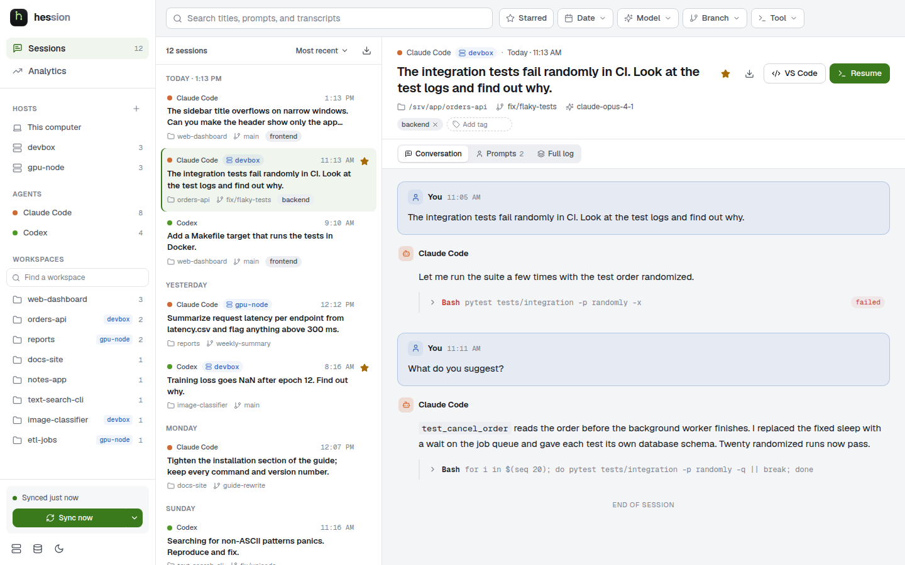

<p align="center">
  <picture>
    <source media="(prefers-color-scheme: dark)" srcset="branding/wordmark.svg">
    
  </picture>
</p>

A desktop app to search, read, analyze, and resume your coding-agent sessions,
both the ones on this computer and the ones on the SSH hosts you work on
(for example through VS Code Remote-SSH).

- **One library** for Claude Code, Codex, OpenCode, Cline, Pi, Command Code,
  Muse, Hermes Agent, and Antigravity sessions
- **Remote hosts**: sessions on your SSH machines are copied in on each sync
  and work like local ones
- **Full-text search** over transcripts, with filters for agent, host,
  workspace, model, branch, tool, and date
- **Resume** a session in its agent CLI, locally or over `ssh`, or **open
  its folder in VS Code**
- **Analytics** for tokens, estimated cost, tools, and failures
- **Local-first**: everything is stored in a SQLite database on your machine

<picture>
  <source media="(prefers-color-scheme: dark)" srcset="docs/screenshots/sessions-dark.png">
  
</picture>

## Install

Hession runs on macOS (Apple silicon and Intel) and Linux (x64 and ARM64).
Install or update to the latest release with:

```sh
curl -fsSL https://raw.githubusercontent.com/MohamedElashri/hession/main/install.sh | sh
```

The script picks the right package for your system, verifies its SHA-256
checksum, and installs it:

| System | Installs |
| --- | --- |
| macOS | `Hession.app` in `/Applications` (or `~/Applications`) |
| Debian, Ubuntu | the `.deb` package (asks for `sudo`) |
| Fedora, openSUSE, RHEL | the `.rpm` package (asks for `sudo`) |
| Other Linux, or `--appimage` | the AppImage in `~/.local`, with a `hession` command and menu entry |

Run the same command again to update. Options go after `sh -s --`, for example
`... | sh -s -- --appimage`: `--version v0.1.0`, `--force`, `--uninstall`, and
`--help`. Your session library in `~/.hession` is never touched. Installers are
also on the [releases page](https://github.com/MohamedElashri/hession/releases).

To build from source instead, see [development](docs/development.md).

## Quick start

1. Open the app. It imports local agent history on first launch.
2. To add remote machines, click **+** next to *Hosts* in the sidebar and pick
   hosts from the suggestions (VS Code Remote-SSH history, `~/.ssh/config`) or
   type one. Then click **Sync now**.
3. Select a session to read it. Choose **Resume** to continue it in a
   terminal, or **VS Code** to open its workspace.

## How it works

- **Reads** each agent's own history files (for example `~/.claude/projects`).
  It never writes to them.
- **Stores** an indexed copy in `~/.hession/sessions.sqlite`. Sync only
  re-reads files whose size or modification time changed.
- **Remote hosts** you add are reached with your `ssh` and `~/.ssh/config`,
  without password prompts. Their history files are copied with `rsync` into
  `~/.hession/remotes/<host>/` and then indexed like local files. Nothing on
  the host is changed.
- **Nothing is uploaded.** Besides your SSH hosts, the only network request
  is a model-price download from [models.dev](https://models.dev), and only
  when you click it in Analytics.

## Documentation

- [User guide](docs/user-guide.md): sync, remote hosts, resume, supported
  agents, data, and troubleshooting
- [Development](docs/development.md): building, testing, project layout,
  branding, and releases

## License

MIT, see [LICENSE](LICENSE).
