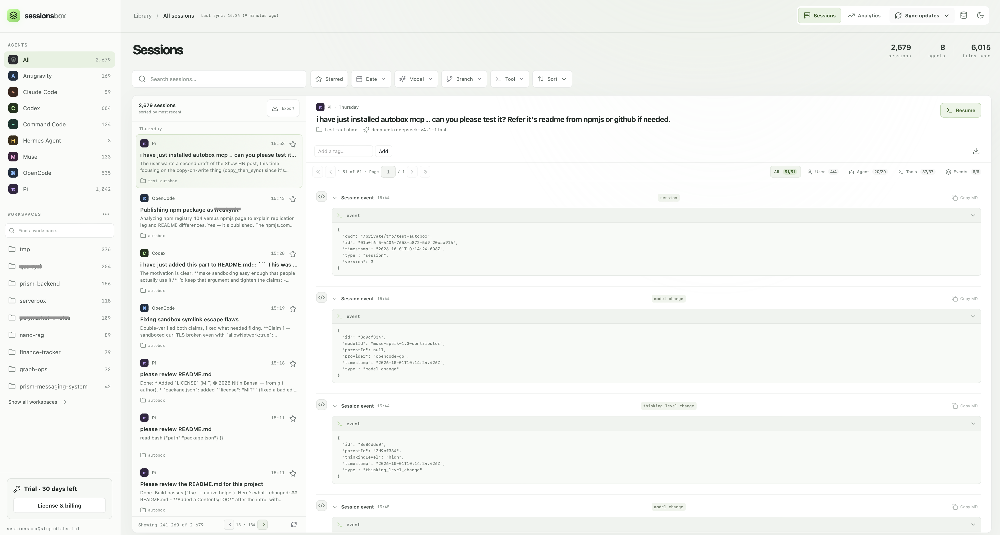

<p align="center">
  <picture>
    <source media="(prefers-color-scheme: dark)" srcset="branding/wordmark.svg">
    
  </picture>
</p>

A desktop app to search, read, analyze, and resume your coding-agent sessions,
both the ones on this computer and the ones on the SSH hosts you work on
(for example through VS Code Remote-SSH).

- **One library** for Claude Code, Codex, OpenCode, Cline, Pi, Command Code,
  Muse, Hermes Agent, and Antigravity sessions
- **Remote hosts**: sessions on your SSH machines are copied in on each sync
  and work like local ones
- **Full-text search** over transcripts, with filters for agent, host,
  workspace, model, branch, tool, and date
- **Resume** a session in its agent CLI, locally or over `ssh`, or **open
  its folder in VS Code**
- **Analytics** for tokens, estimated cost, tools, and failures
- **Local-first**: everything is stored in a SQLite database on your machine



## Install

There are no prebuilt releases yet. Build it from source (Linux shown; see
[development](docs/development.md) for macOS and Windows):

```sh
git clone https://github.com/MohamedElashri/hession && cd hession
make deps      # system libraries (sudo)
make deb       # or: make appimage, make rpm, make build
sudo apt install ./src-tauri/target/release/bundle/deb/*.deb
```

## Quick start

1. Open the app. It imports local agent history on first launch.
2. To add remote machines, click the **server icon** next to *Hosts* in the
   sidebar and pick hosts from the suggestions (VS Code Remote-SSH history,
   `~/.ssh/config`) or type one. Then choose **Sync updates**.
3. Select a session to read it. Choose **Resume** to continue it in a
   terminal, or **VS Code** to open its workspace.

## Documentation

- [User guide](docs/user-guide.md): sync, remote hosts, resume, supported
  agents, data, and troubleshooting
- [Development](docs/development.md): building, testing, project layout,
  branding, and releases

## License

MIT, see [LICENSE](LICENSE). Hession is a fork of
[Sessions Box](https://github.com/goodappsstore/sessions-box) by GoodApps.
