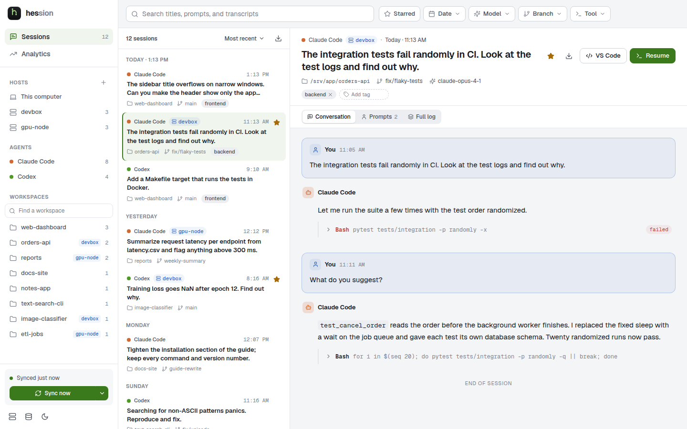

<p align="center">
  <picture>
    <source media="(prefers-color-scheme: dark)" srcset="branding/wordmark.svg">
    
  </picture>
</p>

Search, read, analyze, and resume your coding-agent sessions on macOS and Linux.
Keep local and SSH histories in one offline library, optionally sync between
devices through your own encrypted relay, or continue a task in another harness.

<picture>
  <source media="(prefers-color-scheme: dark)" srcset="docs/screenshots/sessions-dark.png">
  
</picture>

## Install

macOS: Apple silicon or Intel. Linux: x64 or ARM64.

```sh
curl -fsSL https://raw.githubusercontent.com/MohamedElashri/hession/main/install.sh | sh
```

The installer verifies checksums and selects a macOS app, Debian/RPM package,
or AppImage. Download packages directly from
[Releases](https://github.com/MohamedElashri/hession/releases).

Open **Settings** for appearance, terminal, history refresh, remote hosts, private
sync, continuation, and saved data. Update through **Settings → About → Check for
updates → Download and install → Restart Hession**.
In-app downloads are signature-verified. Linux system packages may request
administrator authorization. Your library is kept when updating or uninstalling.
Installer options: `--appimage`, `--version v0.4.0`, `--force`, `--uninstall`,
`--help`; pass them after `sh -s --`.

## Start here

1. Open Hession to import local agent histories. **Refresh histories** imports
   changes; its menu controls startup refresh and full rescans.
2. Add an SSH machine with **+** beside **Hosts**, then refresh. SSH must work
   without password prompts, and `rsync` must be installed on both machines.
3. Search or filter sessions, read the conversation or full log, and use
   **Resume** to reopen an original session or **VS Code** to open its folder.

Supported histories: Claude Code, Codex, OpenCode, Cline, Pi, Command Code,
Muse, Hermes Agent, and Antigravity. Stars, tags, Markdown/JSON export, token
and cost analytics, appearance options, and terminal preferences are included.

## New in 0.4.0

One **Settings** window brings preferences, remote hosts, saved data, and
**About** together. Check for updates and restart to apply them from About;
the Settings button keeps update progress visible. Section changes preserve
unfinished edits, and saves and backup operations finish before you can leave.

## Optional features

Both features are **optional and disabled by default**, independently on each device.

| Feature | Enable and use |
| --- | --- |
| [Private device sync](docs/private-sync.md) | **Settings → Private sync**: connect to your self-hosted relay, select upload workspaces, preview, save the recovery key, and enable. Choose **Sync now** for each transfer. |
| [Cross-harness continuation](docs/continuation.md) | **Settings → Continuation**: enable, open a session, then choose **Continue in…**. Review context and a matching local checkout before starting a new Claude Code or Codex session. |

Sync transfers history, stars, and tags, not project files or native agent stores.
Continuation starts a new session with context; it does not move a running agent.

## Privacy and your data

Hession reads original histories without changing them. Its local library is
`~/.hession/sessions.sqlite`; it remains usable offline. There is no Hession
account or telemetry. SSH imports contact your configured hosts. Price downloads
from models.dev and update checks/downloads from GitHub are user-initiated.

Private sync encrypts selected history before sending it to your relay.
Continuation prepares context locally; the destination harness may send that
context to its normal model provider. Local libraries, handoff files, and ordinary
backups contain plaintext. See [security and limits](docs/sync-security.md).

## Guides

- [User guide](docs/user-guide.md): everyday use, supported stores, backups, fixes.
- [Private sync](docs/private-sync.md) · [Self-hosting](docs/self-hosting.md).
- [Continuation](docs/continuation.md) · [What's changed](CHANGELOG.md).
- [Development](docs/development.md) · [Sync protocol](docs/sync-protocol.md).

MIT licensed; see [LICENSE](LICENSE).
